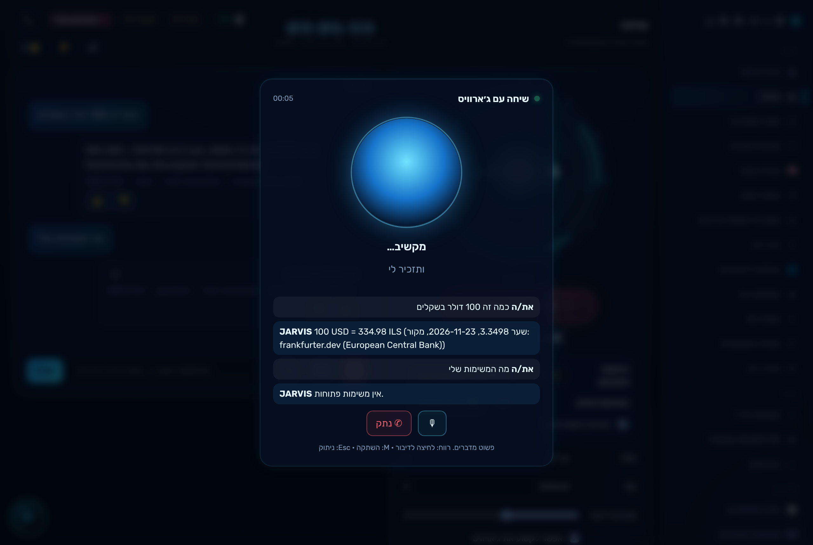

# AI across JARVIS, wake word and renaming

## Hearing and speaking: which engine runs where (`web/js/voice.js`)

| Where JARVIS runs | Hearing (speech → text) | Speaking (text → speech) |
|---|---|---|
| **claude.ai** (Chrome/Edge, desktop app) | **Claude dictation** (Anthropic speech-to-text; the `dictation` capability). Starts from the 🎙 click; the platform asks for consent once | **Claude voices** (the `tts` capability): buttery, airy, glassy or rounded. Language is set per answer (he/en) |
| Website, local server, HTML file (Chrome/Edge/Safari) | The browser's SpeechRecognition | The browser's speechSynthesis. Picks the best voice (your choice, then neural/online, then any), splits text into ≤180-character sentences, and works around Chrome's 15-second cut-off |
| Firefox | none (typing or OS dictation) | speechSynthesis |

Answers are **read aloud by default**. 🔊/🔇 in the top bar mutes, every answer has a 🔊 replay button, and "speak every answer" can limit reading to voice requests.

### 📞 Voice call (`web/js/call.js`)

Start it from 📞 in the top bar, the "Call JARVIS" button (Command and Conversation screens) or Alt+J.

| | |
|---|---|
| Flow | JARVIS listens; you speak; the sentence ends after a natural pause; he answers aloud; he listens again by himself. This repeats until you hang up. |
| Interrupting | Talk while he speaks and he stops. His own voice coming back from the speakers is recognized (most of the heard words match what he is saying) and ignored. |
| Keys | Space = push-to-talk (also stops him), M = mute the microphone, Esc = hang up |
| Robustness | Browsers end recognition on their own after silence or about 60 s; the call restarts it. A microphone that keeps stopping (more than 6 times in 8 s) stops the call with a clear message instead of looping. A speech failure never replaces the answer, which stays on screen. The wake-word listener pauses during the call. |
| Website, server, HTML file (Chrome/Edge) | Fully hands-free |
| claude.ai | Claude dictation may only start from a click or key press, so each turn starts with one tap or the Space key, held while you talk. Answers are spoken in a Claude voice. |
| Fixed along the way | A slow screen render could replace the newer screen when switching quickly, so the message box disappeared. Each render now has its own container. |

Tests:
- `ui.e2e`: two hands-free turns, the echo of his own voice ignored, mute, hang up.
- `webapp.e2e`: a claude.ai call with Claude dictation and voice, and the next turn started with the Space key.

### Settings → Hearing & Voice (`web/js/hearview.js`)

| Setting | What it does |
|---|---|
| Microphone + live meter | Lists the microphones and shows the real input level ("✓ hearing you"). It also shows the precise error for a blocked mic, no mic, or a mic in use by another app. Chrome/Edge recognition always uses the browser's default mic, and the screen says where to change it. |
| Recognition test | Shows exactly what was heard, the recognizer's confidence and the time taken. It warns when confidence is low. Nothing is sent. |
| Language | he-IL, en-US, en-GB, ar-IL, ru-RU, fr-FR, es-ES |
| End of sentence after a pause | Continuous recognition with JARVIS's own end-of-sentence timer: first pause, 0.9, 1.4 (default), 2 or 3 s. A short breath no longer cuts the sentence off. |
| After hearing | Send at once, or put the text in the box to check it before sending |
| Conversation mode | Keeps listening for the next sentence after an answer |
| Interrupting | You can talk over JARVIS while he speaks |
| Wake word | On/off; sensitivity strict, normal or loose (strict accepts only near-exact spellings); a test box |
| Answering | Read every answer, voice, speed, pitch, volume, and a test button |

### Voice & microphone check (Conversation screen)

The check shows:
- where JARVIS runs and the browser;
- which hearing and speaking engines are active, and the voice chosen;
- the installed Hebrew voices;
- the microphone permission;
- a list of specific problems, each with the fix.

Buttons: **Test speaker** says a sentence, and **Test microphone** shows what was heard. Common problems and their fixes:

| Problem | Message / fix |
|---|---|
| No Hebrew voice on the device (common in Chrome on Windows) | Use Edge, which has built-in Hebrew voices, install a Hebrew voice in Windows, or use claude.ai (Claude voice) |
| Microphone blocked | Allow it from the lock icon in the address bar; inside claude.ai, from the artifact's Permissions menu |
| HTML file opened from disk and the recognizer refuses | Use claude.ai or run the server (`npm start`) |
| Offline in Chrome/Edge | Browser recognition needs the internet |
| Firefox | No recognition; use Chrome/Edge or claude.ai |

In claude.ai, Claude's voice cannot speak while dictation is listening. Push-to-talk stops listening before the answer is spoken. In wake mode (continuous listening) answers are shown as text, with 🔊 to hear one.

## Wake word ("Hey JARVIS" / "ג'ארוויס")

| | |
|---|---|
| Turn on | 👂 button in the top bar. A one-time notice explains that the microphone stays open while the page is open, and that the browser recognizes speech (Chrome and Edge send audio to their speech service) |
| Say | "ג'ארוויס, מה יש לי היום?", or just "ג'ארוויס", then wait for the chime and speak within 8 seconds |
| Matching (`web/js/wake.js`) | Word-by-word normalization (niqqud, final letters, geresh), known spellings (ג׳ארוויס, גארוויס, jervis …), and edit distance of about one per five letters. A phonetic skeleton difference is allowed only in the first sound (J/CH/G/H). Only greetings may come before the name. The command is passed on exactly as spoken |
| Rejected | "jars of water", "harvest moon", "מרוויח כסף", "גרביים חדשים", and the name in the middle or end of a sentence |
| Self-protection | While JARVIS speaks, or push-to-talk is active, wake mode ignores what it hears |
| Settings → Wake word | On/off, plus a test box: type a sentence the way the microphone would hear it and see whether it would wake him and what the command is |
| Limits | Browser-based: works only while the page is open. claude.ai blocks the microphone, and wake mode says so. On-device wake detection is the next step (see `BREAKTHROUGH.he.md`) |

## Renaming

| | |
|---|---|
| By voice or chat | "מעכשיו קוראים לך פריידי", "your name is Friday", "שנה את מילת ההפעלה למחשב", "change the wake word to Computer". These run through the tools `settings.rename` and `settings.wake` (write risk, audited, verified) |
| In Settings | Name and wake word fields. The name must be at least 2 characters |
| Effect | Brand, page title, the system prompt ("You are Friday …"), "who are you?" answers, and the wake listener update immediately. The name and wake word are also stripped from commands ("Friday, organize my day" works) |

## AI layer

| Feature | What it does | Without a model |
|---|---|---|
| Copilot on every screen (✦, Ctrl+K) | Answers questions about the current screen. The server builds the context from its own data (finance, learning, worlds, planner, home, missions, neural, graph, database); the page sends only the screen name. Each screen has suggested questions | Says what is needed and still returns the data |
| AI world designer | When no template fits, or "design with AI" is checked, Claude designs the data model as JSON constrained by a schema (`output_config.format`). JARVIS validates it, with one corrective retry; invalid output is never accepted. It is marked "proposed by AI, review" | Falls back to the deterministic templates and questions |
| Provider | Automatic prompt caching (`cache_control`), server-side refusal fallbacks (`fallbacks: "default"`), refusal category, structured JSON output, and a manual tool loop with all results in one message | Local engine for built-in commands |
| Existing AI | Chat with tools through the permission policy, deep thinking, decisions, research with sources, vision, generators, app builder, agents, missions, model benchmarks, Development Lab code generation | Each says what is missing |

Model output is always data: it is validated, never executed directly, and it cannot change permissions, money or settings by itself.

## API

| Endpoint | Purpose |
|---|---|
| `GET /api/ai/status` | providers, route, AI features |
| `GET /api/ai/suggested?screen=&lang=` | suggested questions for a screen |
| `POST /api/ai/copilot {screen, question, lang, worldId?}` | ask the copilot |
| `POST /api/worlds {text, ai:true}` | AI-designed world |
| `PUT /api/settings/personality {name, wakeWord}` | rename / set the wake word |

## Tests

- `tests/assistant.test.js` (5 tests): wake matching with positives and negatives, rename by voice and stripping, the AI designer with schema, caching, fallbacks and corrective retry, honest behavior with no model, copilot grounding.
- `tests/e2e/webapp.e2e.mjs`: simulated speech. Saying "ג׳ארוויס כמה הוצאנו החודש" runs the command; a sentence without the wake word is ignored; a voice rename changes the brand and the wake word; the copilot opens on a screen.
